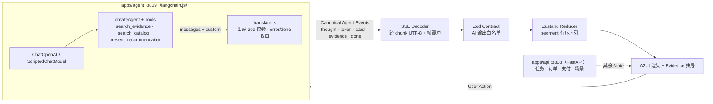
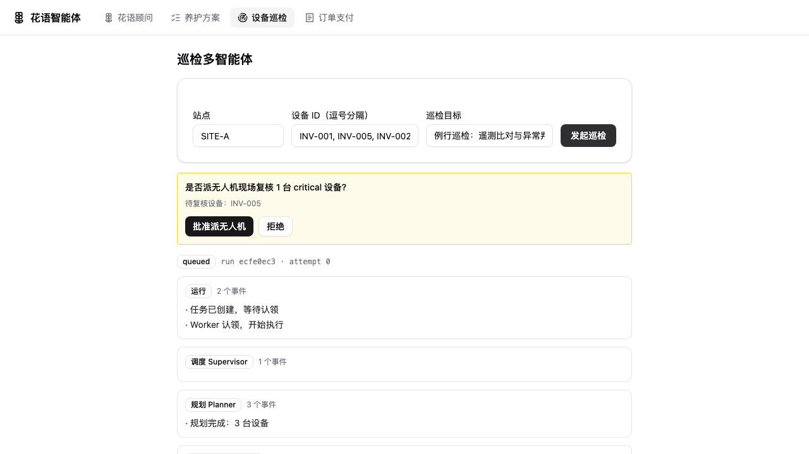
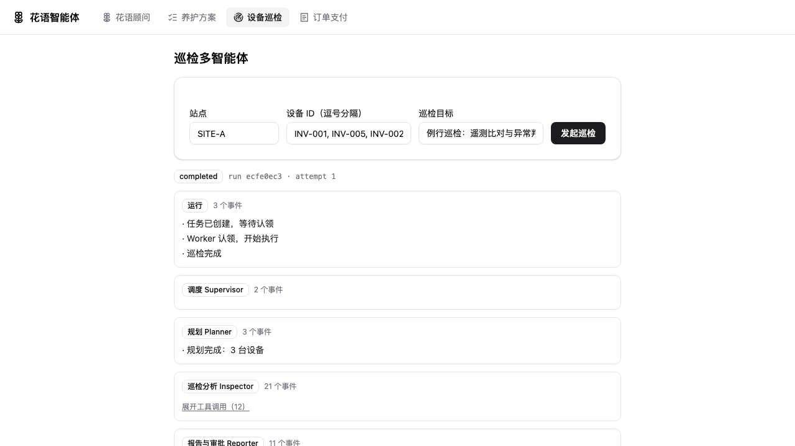

# agent-hub · 花语智能体（Flora Advisor）

一个可运行的 AI 应用工程演示：以「花店选购顾问」为场景，把支撑 AI 产品的四条工程主线做成最小可信实现；并以「设备巡检多智能体」（/runs）补齐第五条主线——**多智能体编排、持久化运行时（租约/fencing/CAS）、检索证据、评测质量门**。重点不在聊天页面，而在页面之下的管线——**流式事件协议、结构化渲染、证据溯源、异步任务恢复**。

React 19 + TypeScript 7 + Vite 8 + Zustand 5 + Zod 4 · 智能体服务 langchain.js（`apps/agent`，Node 24 直跑 TS） · FastAPI + Pydantic v2（任务 / 订单 / 支付）

**无需真实 API Key**：未配置 Key 时由确定性离线剧本驱动（`ScriptedChatModel`，与真实模型共享同一张 createAgent 图，离线可跑、输出可断言）。

## 架构



进程拓扑：Vite :8888 把 `/api/agent/*` 与 `/api/evidence/*` 代理到 TS 智能体 :8809，其余 `/api/*` 仍到 FastAPI :8808。换 LLM 供应商只动 `llm.ts` 的 provider 表，前端与事件协议零改动。

### 5. Inspection Multi-Agent Runtime（巡检多智能体，/runs）

- **问题**：花语对话是"一问一答"的单智能体；生产级 Agent 需要多设备编排、持久化、断点恢复与人工审批——这些能力在「能跑」与「能扛住生产」之间隔着整个运行时工程。
- **实现**：Supervisor + 规划/巡检分析/报告三类 Worker（LangGraph StateGraph，`Send` 扇出、`interrupt` 人工审批、SQLite 检查点）；持久化运行时（租约 + 心跳 + fencing token + CAS，进程被强制终止后自动接管续跑，过期执行者写入一律拒绝）；写工具经幂等账本不重复执行；混合检索（BM25 + 向量 + RRF）为结论提供可回溯的证据 chunk_id；权限、步数、Token 预算由工具执行器用代码强制。运行库事件按 seq 持久化，页面刷新/断线按 `Last-Event-ID` 续传。
- **验证**：`pnpm test:api` 覆盖契约不变量（并发认领单一胜者、被顶替写入被拒、终态吸收、事件 seq 无空洞、幂等账本）与 kill -9 故障注入续跑；`pnpm test:e2e` 三条巡检用户故事（审批全链路 / 刷新恢复 / 审批拒绝）；`evals.gate` 离线评测质量门低于阈值即 CI 红。
- **演示**：设备巡检页发起巡检 → 时间线按节点推进 → critical 设备触发审批 → 批准/拒绝 → 报告（覆盖率、分级 findings、证据 chunk 引用、工单）。





## 四条主线

### 1. Streaming Agent Event Pipeline

- **问题**：LLM 输出是字节流，`EventSource` 不支持 POST / 自定义头 / 中断；多字节中文与 SSE 帧边界都可能被网络 chunk 从中间劈开。
- **实现**：五类规范事件（`thought` / `token` / `card` / `evidence` / `done`）作为跨端契约；`decodeUtf8Stream` 用 TextDecoder streaming 模式兜住跨 chunk 多字节序列，`createSseParser` 用行缓冲在空行处派发帧、`flush` 冲出残帧；前端 fetch ReadableStream 逐帧解析，`AbortController` 支持停止生成。
- **验证**：`pnpm test:shared` 覆盖「中文多字节被 chunk 劈开」「帧被 chunk 劈开」「CRLF / 注释行 / flush 残帧」等用例；`pnpm test:web` 通过受控 HTTP 流验证停止后重发时旧事件、异常与 EOF 不影响新回答，未收到 `done` 的 EOF 明确显示截断。

### 2. A2UI Structured Rendering

- **问题**：让 LLM 直接生成 UI 不可控也无法校验；自由文本承载不了可行动的推荐。
- **实现**：卡片是工具 `present_recommendation` 的产物——商品字段（名称/价格/类型/emoji）只从服务端目录填充，模型只能传 `skuId`，无法报价；前端 zod `parse` 通过才渲染，按场景（日常自用 / 送礼 / 探望慰问）切换卡片段式。
- **验证**：契约测试断言「契约外字段被拒绝」；演示：对话获取推荐卡片，点「下单」进入订单流。

### 3. Evidence Traceability

- **问题**：AI 结论必须能指认「从哪来」，否则不可信也不可用。
- **实现**：结论与依据分离——卡片只携带 `evidenceId` 引用，证据事件包含来源、可信度、引用原文、分析时间。因果校验：`present_recommendation` 只接受**本轮** `search_evidence` 真的返回过的证据 id、`search_catalog` 返回过的 skuId，不满足就抛错回灌给模型自我修正（杜绝"引用洗白"）。当前证据字段来自服务端固定 fixture，可信度不是实时计算结果；前端只做分级渲染（<80 金色预警）。
- **验证**：SSE 冒烟断言 evidence 事件序列与证据库一致；演示：点卡片上的「依据」打开证据抽屉。

### 4. Async Task Recovery

- **问题**：长耗时 AI 任务会跨越刷新与断线，前端需要状态机而不是布尔 loading。
- **实现**：`queued → running(progress) → completed / failed / cancelled → archived` 状态机；3s 轮询；`taskId` 存 localStorage，刷新/重进按远端恢复 snapshot，任务仍在进行（queued / running）则**自动继续轮询直到终态**（远端是事实源，本地只存 UI 态）。服务端重启会读回快照、续单号，并把 queued / running 任务从原进度续跑到终态（不归零）。taskId 哈希尾号 7 确定性失败，便于演示失败分级。
- **验证**：pytest 覆盖推进 / 取消 / 确认归档 / 确定性失败 / 404；E2E 覆盖「创建 → 刷新 → 恢复 → 自动续追到终态」全链路；演示：创建任务后刷新页面，无需任何操作直到完成。

## Quick Start

```bash
pnpm install      # JS workspace 依赖
pnpm api:setup    # python venv + pip install -e apps/api[dev]
pnpm demo         # 一键启动 FastAPI :8808 + TS 智能体 :8809 + Vite :8888
# 或容器化一键演示（巡检 LLM 默认离线确定性档，无需真实 Key）：
docker compose up --build   # 打开 http://localhost:8888
```

打开 <http://localhost:8888>：

1. **对话页 `/`**：提问「想给妈妈送生日礼物」→ 思考分段流式 → 推荐卡片 → 点「依据」看溯源 → 点「下单」。
2. **任务页 `/tasks`**：创建养护方案生成任务 → 轮询进度 → 刷新页面按 `taskId` 恢复并自动追踪到终态。
3. **订单页 `/orders`**：沙箱收银台完成模拟支付，重复回调不会重复入账。

前置：Node ≥ 24（pnpm 12）、Python ≥ 3.12。

## 演示

**对话流式 + A2UI 卡片**（输入 → 思考分段 → 推荐卡 → 下单入口）：


**证据溯源**（卡片「依据」入口 → 来源 / 可信度 / 引用原文）：


**异步任务**（创建 → 刷新恢复并自动续追到终态 → 确认归档）：


完整演示录屏见 [Releases](../../releases)。

## 验证

| 命令               | 覆盖                                                                                                                                                                                 |
| ------------------ | ------------------------------------------------------------------------------------------------------------------------------------------------------------------------------------ |
| `pnpm build`       | `tsc -b` + `vite build`（类型与构建门槛）                                                                                                                                            |
| `pnpm test:shared` | SSE 解码器 / 契约 / bones 断点选择（node:test）                                                                                                                                      |
| `pnpm test:web`    | 公开聊天 store + 受控 HTTP 流：旧请求隔离 / 截断提示（node:test）                                                                                                                    |
| `pnpm test:api`    | 契约镜像 / 任务状态机（含重启续跑）/ 支付沙箱（pytest）                                                                                                                               |
| `pnpm test:agent`  | 工具因果校验 / 事件翻译 / 三场景剧本 / 多轮记忆与摘要 / HTTP 层 / 真实路径（ChatOpenAI × 本地假上游）（node:test）                                                             |
| `pnpm test:e2e`    | 七条端到端用例：流式分段渲染 / 证据抽屉 / 任务恢复并自动追踪到终态 / 多轮 threadId + 巡检三条（审批全链路 / 刷新恢复审批条 / 审批拒绝）（Playwright，离线剧本驱动无需 Key）                                  |
| `python -m evals.gate` | 离线评测质量门：检索 Recall@k / 智能体成功率 / 越权次数低于阈值时退出码非 0（CI 红）；离线数字仅验证流程，不代表模型效果 |
| `python -m app.runtime.demo_crash` | 运行时崩溃恢复演示：kill -9 → 回收 → 续跑 → 完成（事件序列 + attempt/fencing token 演进） |

推送即跑 CI（Node 24 + Python 3.12）。

## Additional engineering examples

- **支付沙箱**：订单状态机（created → paying → paid / closed）+ SHA-256 验签 + 幂等回调（重复回调返回 `duplicate: true`）+ 渠道绑定校验。
- **Boneyard 骨架屏**：真实内容保持挂载（`display: contents` 无盒包裹，骨架消失零重排）、overlay `pointer-events: none` 不拦截交互、URL `?boneyard=all` 预览验收、bones fixture 按断点捕获。
- **契约双镜像**：`contracts.ts`（zod）是单一事实源；`schemas.py`（pydantic）只镜像 Python 仍在用的任务 / 订单 / 场景部分，两端以 `fixtures/contract-example.json` 对账（事件段只由 TS 校验）。
- **真实 LLM 接入**：在仓库根 `.env` 填入 `OPENAI_API_KEY`（deepseek / kimi / glm / openai 均兼容 OpenAI 协议），`apps/agent` 启动时自动加载；`OPENAI_PROVIDER` / `OPENAI_BASE_URL` / `OPENAI_MODEL` 同旧版。可选 `AGENT_SUMMARY_MODEL` 启用长对话摘要。`.env` 只在进程启动时读取——修改后需重启 demo（Ctrl+C 后重新 `pnpm demo`）才生效；留空 key 自动回退离线剧本。
- **多轮记忆**：前端首次发送生成 `threadId`，服务端 `MemorySaver` 按 thread 存储；"清空"重置会话。进程内存储，重启丢失（ADR-0005）。

## Limitations

单机演示定位：花语侧进程内存储、无鉴权、支付为沙箱模拟（SSE 断线续传已由巡检 /runs 实现）。生产化差距（DB 唯一键 + 分布式锁、平台公钥验签等）在代码注释与 [docs/adr](docs/adr/) 中注明。

巡检侧口径：**fixtures/inspection 全部为合成数据**（生成器 `fixtures/inspection/generate.py` 可复现），检索与评测数字均为离线确定性口径（`evals/reports/` 有方法/样本量/方差/已知偏差声明），**仅验证工程流程，不代表模型效果**。服务端任务续跑的分层覆盖：store 层进程重启（含 kill -9）由 `tests/runtime/test_kill9_reclaim.py` 覆盖；编排层「审批等待期重启→重认领→从检查点恢复」由 `tests/agents/test_runner_resume.py` 覆盖（回归过 findings 翻倍缺陷）；E2E 覆盖页面刷新恢复与断线续传，不覆盖进程重启。真实模型（`OPENAI_API_KEY`）下 planner/inspector 的输出质量取决于所选模型，离线剧本仅供流程与不变量验证。

任务恢复：页面刷新续追由远端快照保证；后端重启会把 queued / running 任务从快照进度续跑（单测覆盖，E2E 不覆盖进程重启）。记忆为进程内 `MemorySaver`，重启丢失；threadId 由前端生成且未鉴权，上线前需改为服务端签发。证据库是固定演示 fixture，尚无真实顾客数据接入或可信度算法评测。

## License

[MIT](LICENSE)
