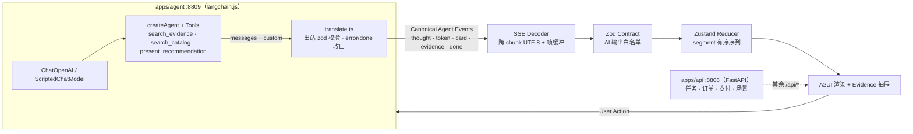
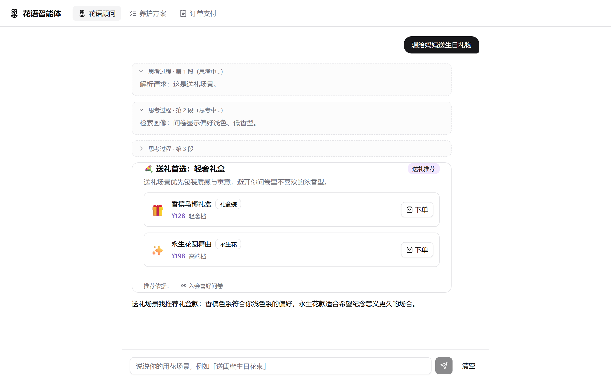
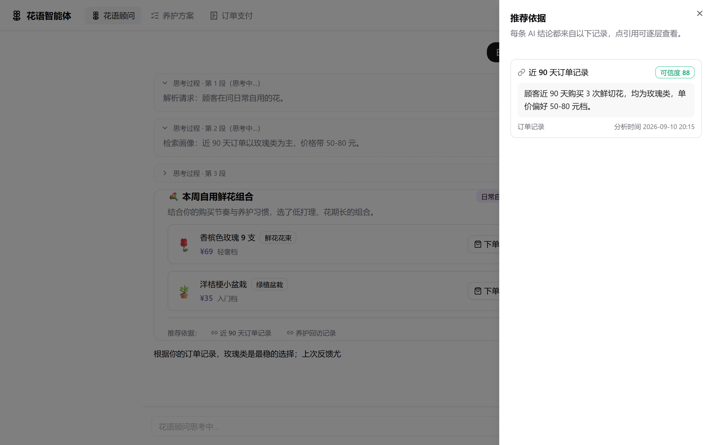
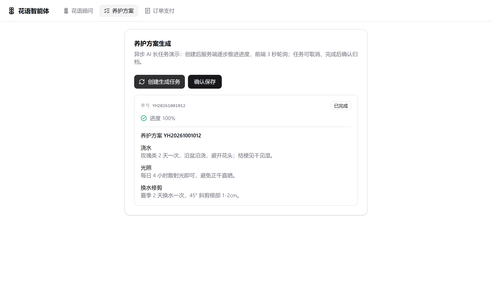

# 花语智能体（Flora Advisor）· 流式渲染与 A2UI 演示

> 定位：**前端与流式事件工程演示**（原 agent-hub 主场景）。巡检多智能体（后端 Agent 工程）见 [docs/inspection.md](inspection.md)。

一个以「花店选购顾问」为场景的最小可信实现，重点不在聊天页面，而在页面之下的管线——**流式事件协议、结构化渲染、证据溯源、异步任务恢复**。

React 19 + TypeScript 7 + Vite 8 + Zustand 5 + Zod 4 · 智能体服务 langchain.js（`apps/agent`，Node 24 直跑 TS） · FastAPI + Pydantic v2（任务 / 订单 / 支付）

**无需真实 API Key**：未配置 Key 时由确定性离线剧本驱动（`ScriptedChatModel`，与真实模型共享同一张 createAgent 图，离线可跑、输出可断言）。

## 架构

进程拓扑：Vite :8888 把 `/api/agent/*` 与 `/api/evidence/*` 代理到 TS 智能体 :8809，其余 `/api/*` 仍到 FastAPI :8808。换 LLM 供应商只动 `llm.ts` 的 provider 表，前端与事件协议零改动。

## 四条工程主线

### 1. Streaming Agent Event Pipeline

- **问题**：LLM 输出是字节流，`EventSource` 不支持 POST / 自定义头 / 中断；多字节中文与 SSE 帧边界都可能被网络 chunk 从中间劈开。
- **实现**：五类规范事件（`thought` / `token` / `card` / `evidence` / `done`）作为跨端契约；`decodeUtf8Stream` 用 TextDecoder streaming 模式兜住跨 chunk 多字节序列，`createSseParser` 用行缓冲在空行处派发帧、`flush` 冲出残帧；前端 fetch ReadableStream 逐帧解析，`AbortController` 支持停止生成。
- **验证**：`pnpm test:shared` 覆盖「中文多字节被 chunk 劈开」「帧被 chunk 劈开」「CRLF / 注释行 / flush 残帧」等用例；`pnpm test:web` 通过受控 HTTP 流验证停止后重发时旧事件、异常与 EOF 不影响新回答，未收到 `done` 的 EOF 明确显示截断。

### 2. A2UI Structured Rendering

- **问题**：让 LLM 直接生成 UI 不可控也无法校验；自由文本承载不了可行动的推荐。
- **实现**：卡片是工具 `present_recommendation` 的产物——商品字段（名称/价格/类型/emoji）只从服务端目录填充，模型只能传 `skuId`，无法报价；前端 zod `parse` 通过才渲染，按场景（日常自用 / 送礼 / 探望慰问）切换卡片段式。
- **验证**：契约测试断言「契约外字段被拒绝」；演示：对话获取推荐卡片，点「下单」进入订单流。

### 3. Evidence Traceability

- **问题**：AI 结论必须能指认「从哪来」，否则不可信也不可用。
- **实现**：结论与依据分离——卡片只携带 `evidenceId` 引用，证据事件包含来源、可信度、引用原文、分析时间。因果校验：`present_recommendation` 只接受**本轮** `search_evidence` 真的返回过的证据 id、`search_catalog` 返回过的 skuId，不满足就抛错回灌给模型自我修正（杜绝"引用洗白"）。当前证据字段来自服务端固定 fixture，可信度不是实时计算结果；前端只做分级渲染（<80 金色预警）。
- **验证**：SSE 冒烟断言 evidence 事件序列与证据库一致；演示：点卡片上的「依据」打开证据抽屉。

### 4. Async Task Recovery

- **问题**：长耗时 AI 任务会跨越刷新与断线，前端需要状态机而不是布尔 loading。
- **实现**：`queued → running(progress) → completed / failed / cancelled → archived` 状态机；3s 轮询；`taskId` 存 localStorage，刷新/重进按远端恢复 snapshot，任务仍在进行（queued / running）则**自动继续轮询直到终态**（远端是事实源，本地只存 UI 态）。服务端重启会读回快照、续单号，并把 queued / running 任务从原进度续跑到终态（不归零）。taskId 哈希尾号 7 确定性失败，便于演示失败分级。
- **验证**：pytest 覆盖推进 / 取消 / 确认归档 / 确定性失败 / 404；E2E 覆盖「创建 → 刷新 → 恢复 → 自动续追到终态」全链路；演示：创建任务后刷新页面，无需任何操作直到完成。

## 演示

**对话流式 + A2UI 卡片**（输入 → 思考分段 → 推荐卡 → 下单入口）：

**证据溯源**（卡片「依据」入口 → 来源 / 可信度 / 引用原文）：

**异步任务**（创建 → 刷新恢复并自动续追到终态 → 确认归档）：

完整演示录屏见 [Releases](../../releases)。

## 其他工程示例

- **支付沙箱**：订单状态机（created → paying → paid / closed）+ SHA-256 验签 + 幂等回调（重复回调返回 `duplicate: true`）+ 渠道绑定校验。
- **Boneyard 骨架屏**：真实内容保持挂载（`display: contents` 无盒包裹，骨架消失零重排）、overlay `pointer-events: none` 不拦截交互、URL `?boneyard=all` 预览验收、bones fixture 按断点捕获。
- **契约双镜像**：`contracts.ts`（zod）是花语侧单一事实源；`schemas.py`（pydantic）只镜像 Python 仍在用的任务 / 订单 / 场景部分，两端以 `fixtures/contract-example.json` 对账（事件段只由 TS 校验）。巡检侧契约见 [inspection.md](inspection.md)。
- **真实 LLM 接入**：在仓库根 `.env` 填入 `OPENAI_API_KEY`（deepseek / kimi / glm / openai 均兼容 OpenAI 协议），`apps/agent` 启动时自动加载；`OPENAI_PROVIDER` / `OPENAI_BASE_URL` / `OPENAI_MODEL` 同旧版。可选 `AGENT_SUMMARY_MODEL` 启用长对话摘要。`.env` 只在进程启动时读取——修改后需重启 demo（Ctrl+C 后重新 `pnpm demo`）才生效；留空 key 自动回退离线剧本。
- **多轮记忆**：前端首次发送生成 `threadId`，服务端 `MemorySaver` 按 thread 存储；"清空"重置会话。进程内存储，重启丢失（ADR-0005）。

## 边界与诚实口径

- 单机演示定位：进程内存储、无鉴权、支付为沙箱模拟。生产化差距（DB 唯一键 + 分布式锁、平台公钥验签等）在代码注释与 [ADR](../docs/adr/) 中注明。
- 任务恢复：页面刷新续追由远端快照保证；后端重启从快照进度续跑有单测覆盖。
- 记忆为进程内 `MemorySaver`，重启丢失；threadId 由前端生成且未鉴权，上线前需改为服务端签发。
- 证据库是固定演示 fixture，尚无真实顾客数据接入或可信度算法评测。
