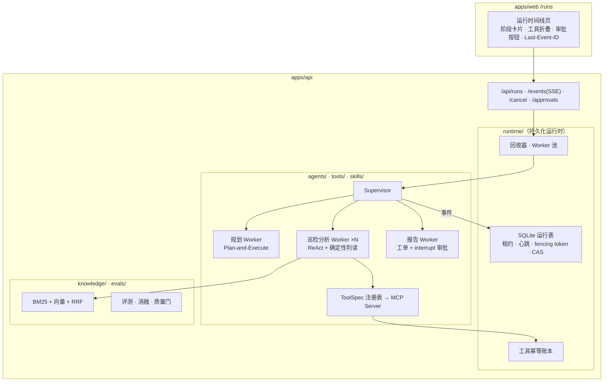

# 设备巡检多智能体 · Inspection Multi-Agent Runtime

> 定位：**后端 Agent 工程演示**——多智能体编排、持久化运行时、工具/MCP/Skill、混合检索、评测与消融。花语（流式渲染与 A2UI 演示）见 [docs/flora.md](flora.md)。

一个贴合「无人机/设备巡检」业务形态的可运行演示：Supervisor + 三类 Worker 编排一批设备巡检任务，进程随时可被 `kill -9`，任务自动接管续跑、过期执行者的写入一律拒绝、副作用不重复发生。

Python 3.12 · FastAPI · LangGraph（StateGraph / Send / interrupt / SQLite 检查点）· SQLite（WAL）· React 前端 `/runs`

## 架构与不变量

每条运行时不变量都有自动化测试（详见下表），机制深读（含代码行号与口述稿）见 [docs/interview/deep-dive.md](interview/deep-dive.md)：

| 不变量 | 保证机制 | 测试 |
|---|---|---|
| 同一时刻一个 run 只有一个有效执行者 | 租约 + fencing token（认领即递增） | `tests/runtime/test_claim_lease.py`（并发单一胜者） |
| 过期执行者的写入一律无效 | CAS（`WHERE fencing_token=? AND status='running'`） | `tests/runtime/test_cas_writes.py` |
| 进程崩溃后任务最终结束（不僵尸） | 回收器 + 重认领续跑 | `tests/runtime/test_kill9_reclaim.py`（SIGKILL 注入） |
| 写工具不重复执行 | 幂等账本（键跨 attempt 可复现） | `tests/runtime/test_tool_ledger.py` |
| 审批等待期重启可恢复 | 检查点 pending interrupt → `Command(resume)` | `tests/agents/test_runner_resume.py` |
| 权限/步数/Token 预算由代码强制 | 工具执行器统一入口（提示词约束之外的运行时门） | `tests/tools/test_executor.py` |
| 事件 seq 严格递增可续传 | 事务内分配 + `events_after` | `tests/runtime/test_event_log.py` |
| 终态不可逆 | 状态机终态吸收 | `tests/runtime/test_state_machine.py` |

## 编排与工具

- **Supervisor + 三类 Worker**：规划（Plan-and-Execute，校验失败重试 2 次后确定性兜底）→ `Send` 并行扇出（每设备一个巡检子任务，`asyncio.wait_for` 超时降级 partial + 覆盖率）→ 报告（结构化工单 + critical 设备经 LangGraph `interrupt` 人工审批，审批 id 贯通事件流）。
- **上下文隔离**：子任务只收「任务简报 + 本设备遥测摘要」，完整历史不进子任务（Token 上限 CI 断言）；Supervisor 只汇总结构化 Finding。
- **工具分级**：`read / write / dangerous`——write 走幂等账本、dangerous 必须人工审批；节点级权限（`allowed_nodes`）由执行器强制，越权以 `tool.denied` 事件化而非崩溃。确定性异常判读（阈值/趋势/阶跃/骤降）是工具不是提示词——数值判断交给代码，LLM 只做解释与决策。
- **MCP / Skill**：同一 ToolSpec 注册表暴露为 MCP Server（`dangerous` 工具不外露，stdio 真机冒烟通过）；三个 Skill = 提示片段 + 工具白名单 + 输出 Schema，白名单并集由执行器强制。
- **混合检索**：BM25（字符 bigram，与 jieba 实测对比后选定）+ 确定性 Hashing 向量 + RRF(k=60) 融合；chunk_id 内容不变则不变（证据引用稳定）；空结果不编造；未观测 chunk 引用被剔除。

## 评测与消融

全部报告在 `apps/api/evals/reports/`（含方法、样本量、方差、已知偏差声明）。**离线数字仅验证流程，不代表模型效果**；效果类结论只在真实模型报告中给出。

| 报告 | 内容 | 口径 |
|---|---|---|
| `e1-offline-*` | 多 vs 单智能体，50 条 × 2 配置 × 3 轮；双口径工具 P/R（process-strict / goal-oriented） | 离线（仅验证流程） |
| `e1-real-20261025-011659` | E1 真实模型（deepseek-chat，50 条 × 3 轮，双口径）：成功率 multi 96.7% vs single 98.7%、goal 召回 99.2%/98.4%、时延 P95 8.6s vs 26.2s、输入 Token 879K vs 2.25M | 真实模型 |
| `e3-real-20261025-015300` | E3 真实模型：并行 P50/P95 4.6s/6.5s vs 串行 7.1s/19.1s（6+ 台设备 P50 相差 3.9×） | 真实模型 |
| `e4-offline-20261025-024152` | E4 上下文载荷对照（简报 vs 完整历史）：质量一致、输入 Token 2.58× | 离线（仅验证流程） |
| `e7-injection-20261025-024832` | E7 提示注入版（注入 1008 次请求：on 全拦 / off 站级越权执行 336 次） | 离线（仅验证流程） |
| `e3-offline-*` | 并行 vs 串行扇出时延（替身层，结构关系） | 离线（仅验证流程） |
| `e7-offline-*` | 运行时强制权限 vs 仅提示词声明（越权 336 次请求：on 全拦 / off 放行站点级越权 112 次） | 离线确定性 |
| `ablation-retrieval-*` | 检索消融 6 配置（hybrid/bm25/vector × 分词） | 离线确定性 |

`python -m evals.gate` 离线质量门：检索 Recall@k / 智能体成功率 / 越权次数低于阈值即退出码非 0（CI 红）。

## 演示

**审批中断**（critical 设备 → 人工审批条 → 批准/拒绝）：

**终态报告**（覆盖率、分级 findings、证据 chunk 引用、工单）：

- 页面演示：`/runs` 发起巡检 → 时间线按节点推进 → 审批 → 报告。
- 命令行演示：`python -m app.runtime.demo_crash` 打印「kill -9 → 回收 → 续跑 → 完成」完整事件序列（attempt/fencing token 演进）。
- 断点恢复 E2E：`pnpm test:e2e` 含两条 SIGKILL 重启用例（运行中重启续跑 / 审批等待期重启恢复，写工具不重复执行断言）；`pnpm test:e2e:restart` 单独跑该套件。

## 诚实口径与边界

- **fixtures/inspection 全部为合成数据**（生成器 `fixtures/inspection/generate.py` 确定性可复现）。检索与 E7/E4 消融为离线确定性口径（**仅验证工程流程，不代表模型效果**）；E1/E3 已有真实模型（deepseek-chat，2026-10-25）报告，结论仅适用于本合成评测集与本提示词/工具面。
- 服务端任务续跑的分层覆盖：store 层进程重启（含 kill -9）由 `tests/runtime/test_kill9_reclaim.py` 覆盖；编排层「审批等待期重启→重认领→从检查点恢复」由 `tests/agents/test_runner_resume.py` 覆盖（回归过 findings 翻倍与异步 approver 两个缺陷）；浏览器层进程重启由两条 E2E 覆盖（kill 落点实际稳定处于审批等待期，graph-rerun 落点经探针验证）。
- 已知接受的边界：审批 interrupt 恢复会重放 reporter 节点（重复事件按 approval_id 幂等消费、写工具由账本去重）；非中断点的崩溃重跑靠 reducer 按 device_id 去重兜底（planner 会重跑，真实模型下有重复计费）；WAL 多进程高并发写未压测（ADR-0006）。
- 真实模型（`OPENAI_API_KEY` + `OPENAI_BASE_URL`/`OPENAI_MODEL`）下 planner/inspector 的输出质量取决于所选模型；巡检 LLM 默认离线确定性档（`AGENT_HUB_LLM=scripted`）。
